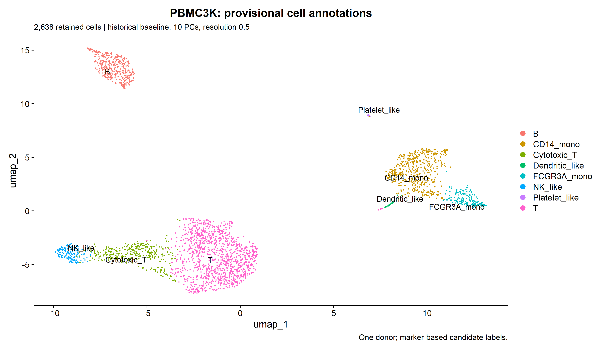
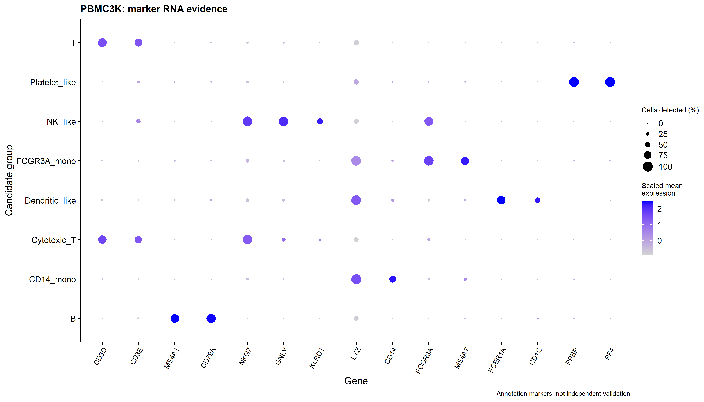

# PBMC3K single-cell RNA-seq analysis in R

A guided portfolio project using public PBMC3K data to demonstrate data quality
review, Seurat analysis, marker-based candidate annotation and parameter sensitivity.

**Question:** How do expression-derived cell groups and their broad candidate
annotations change under selected QC and clustering choices?

## Main outputs





The dataset contains cells from one healthy donor. After the baseline QC filter,
2,638 of 2,700 input cells remained. Nine numerical clusters were summarized as
eight candidate categories; two clusters share the broad T label.

| Candidate category | Retained cells |
|---|---:|
| T | 1,145 |
| CD14_mono | 479 |
| B | 344 |
| Cytotoxic_T | 321 |
| FCGR3A_mono | 160 |
| NK_like | 140 |
| Dendritic_like | 35 |
| Platelet_like | 14 |

These are candidate labels from selected RNA markers, not validated cell identities.
Observed cell counts describe this filtered dataset, not blood population proportions.
UMAP positions summarize expression relationships, not physical tissue coordinates.
Dot size indicates the within-group percentage of cells with detected expression;
color represents per-gene scaled mean expression, not absolute comparisons across genes.

## Analysis decisions

- Imported all 32,738 feature rows and 2,700 cell columns (`min.cells = 0`,
  `min.features = 0` at object creation).
- Baseline QC: detected genes > 200 and < 2,500; mitochondrial count percentage < 5.
  Thresholds are exploratory, dataset-specific choices.
- LogNormalize with scale factor 10,000; 2,000 VST variable features; scaling and
  30 calculated PCs, with PCs 1–10 used in the baseline graph.
- Neighbor graph k = 20; Louvain clustering at resolution 0.5; seed 42.
- UMAP using PCs 1–10, 30 neighbors, min.dist = 0.3 and cosine metric.
- Candidate annotations examined using multiple canonical RNA markers.
- Sensitivity checks: resolution 0.8, 15 PCs, and mitochondrial percentage < 10.

The alternative mitochondrial filter retained 2,689 cells, adding 51. Increasing
resolution produced 11 groups rather than 9. Using 15 PCs retained 9 groups but
changed some memberships. Tables compare cells by barcode; numeric cluster labels
are arbitrary. These checks reveal sensitivity and do not establish an optimal pipeline.

## Reproduce

Open `PBMC_project.Rproj` in RStudio. Install Seurat once if needed:

```r
install.packages("Seurat")
```

Wait for the Console `>` prompt. Download the official count archive:

```r
dir.create("data", showWarnings = FALSE)
download.file(
  "https://cf.10xgenomics.com/samples/cell/pbmc3k/pbmc3k_filtered_gene_bc_matrices.tar.gz",
  destfile = "data/pbmc3k_counts.tar.gz", mode = "wb"
)
```

Then run, from the project root:

```r
source("recovered_analysis/rebuild_and_check.R")
```

The runner loads Seurat and reconstructs the analysis from the filtered count
matrix. Outputs go in a new `results/recovered_<timestamp>_<suffix>/` directory.
The committed figures and selected tables record the learner's verified run.
They are preserved; new runs do not overwrite them.

`reference/historical_cell_labels.csv` stores the historical per-cell candidate
labels. For clones without the original Seurat checkpoint, the runner checks the
same barcode set and exact cluster partitions before transferring these labels.
It stops if either differs, requiring renewed marker review. This is reuse of
historical annotations, not independent reference validation or automatic discovery.

The older `restore_saved_results.R` is an optional checkpoint-based utility; it
requires a local annotated RDS and is not the entry point for a fresh clone.

## Verification status

On 19 November 2026 the learner reran the recovered numerical pipeline after
being instructed to restart R. The uploaded Console output confirms:

```text
Same retained cell set: TRUE
Exactly matching cell partitions: TRUE
```

The three sensitivity tables matched the earlier results, and the run completed.
This demonstrates a successful rerun in that environment, not cross-platform
bitwise reproducibility. Exact UMAP coordinate equality was not tested.
The CSV-reference route was also executed successfully on 19 November 2026
from the prepared GitHub folder, without the historical Seurat RDS. It rebuilt
the numeric analysis, confirmed matching cell sets and partitions, attached
historical candidate labels by barcode, and completed the sensitivity checks
and figure exports. This was a local execution check using the existing public
count input, not a test on another computer or a fresh network download.
No package lockfile or continuous integration is claimed.

Recorded software: R 4.6.1, Seurat 6.0.0, SeuratObject 5.4.0, ggplot2 4.0.4.
The run reported packages built under R 4.6.2, underscore-to-dash feature renaming,
and a counts-layer fallback in the pre-normalization QC plot. These messages did
not prevent completion or the observed partition agreement. Actual run versions
and session details are included under results/tables and results/logs.

## Limits and learning provenance

- One donor: no replicated biological condition comparison, disease inference or
  population-level significance test is supported.
- Marker-based labels are provisional. Mixed CD3E signal in the NK-like group,
  small groups, doublets and ambient RNA remain relevant concerns.
- No dedicated doublet calling, ambient correction, external reference annotation
  or independent experimental validation was performed.
- Selected annotation markers are not independent validation; no formal
  differential-expression analysis or novel biological effect is claimed.
- This is a tutorial-informed learning project with guided interpretation and
  assistant-supported code recovery. Earlier source was reconstructed from the
  conversation because the saved Console history contained only the final 512 lines.

Full methods and results: [methods notes](recovered_analysis/docs/methods_and_results.md).
Recovery audit: [provenance](recovered_analysis/docs/recovery_provenance.md).

## Sources

- [10x PBMC3K dataset](https://www.10xgenomics.com/datasets/3-k-pbm-cs-from-a-healthy-donor-1-standard-1-1-0):
  public healthy-donor, Cell Ranger 1.1.0 filtered gene-barcode matrix; provider's
  dataset terms apply. Inputs are downloaded separately rather than redistributed here.
- [Official Seurat PBMC3K tutorial](https://satijalab.org/seurat/articles/pbmc3k_tutorial.html).
- [FindClusters documentation](https://satijalab.org/seurat/reference/findclusters).
- [DotPlot documentation](https://satijalab.org/seurat/reference/dotplot).
